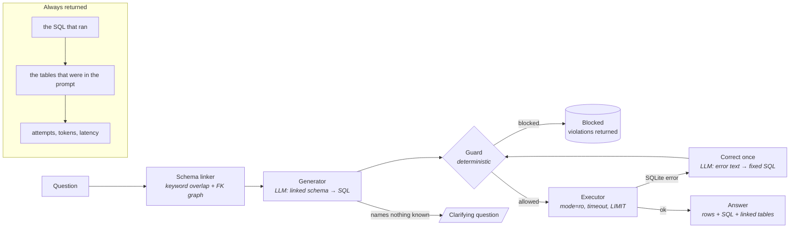

# text-to-sql-agent


A text-to-SQL agent over a synthetic field-service database, with schema grounding, a read-only safety layer, one round of self-correction, and an evaluation harness that scores by **execution accuracy** — does the query return the right rows — rather than by whether the generated SQL looks like the reference SQL.

The point of this repository is the second half. Generating SQL that parses is close to solved. Defining what "correct" means, and proving it on a labelled set you can regenerate in one command, is the part that decides whether anyone should be allowed to run the output.

- **Execution accuracy, not string match.** Two queries are the same answer if they return the same rows. `COUNT(*)` and `COUNT(1)` are not a failure; a query that is one character from the reference and silently drops a `WHERE` clause is.
- **Read-only by construction.** A deterministic guard, then a `mode=ro` connection, then a query timeout. The prompt is not a security control.
- **Clarify instead of guess.** Questions that name nothing in the schema get a question back, and that behaviour is scored.
- **Standard library only.** No install step. Mock LLM by default, so it runs offline and the numbers are reproducible; any OpenAI-compatible endpoint for live mode.

All data is synthetic and generated by a seeded script. Nothing in this repository comes from any employer or client.

## Architecture



The LLM is used in exactly two places: turning a question into SQL, and repairing SQL that SQLite rejected. It never decides whether a query is safe to run. That decision is ordinary code with a list of rules and a test suite full of attacks.

## Quickstart

```bash
git clone https://github.com/Ranjeetyadav47/text-to-sql-agent && cd text-to-sql-agent
python -m t2s generate-data                                  # 50 customers, 200 machines, 2,000 tickets, 90 labelled questions
python -m t2s schema                                         # the schema as the model sees it
python -m t2s ask "top 5 fault codes by ticket count"
python -m t2s ask "which ones are bad"                       # asks back instead of guessing
python -m t2s eval --compare-linking                         # scores the set, writes reports/eval_report.md
```

Python 3.10+. Tests: `PYTHONPATH=.:tests python -m unittest discover -s tests` (or `pytest`).

`service.db` is generated, not committed. `questions.jsonl` is committed, because it is the labelled set the numbers below depend on.

## What an ask looks like

```
$ python -m t2s ask "technicians who closed tickets for customers in Pune"
question : technicians who closed tickets for customers in Pune
status   : ok
linked   : customers, service_tickets, technicians, equipment
sql      : SELECT DISTINCT t.technician_id, t.name FROM technicians t
           JOIN service_tickets st ON t.technician_id = st.technician_id
           JOIN equipment e ON st.equipment_id = e.equipment_id
           JOIN customers c ON e.customer_id = c.customer_id
           WHERE c.city = 'Pune' AND st.status = 'closed' LIMIT 200

  technician_id  name
  -------------  ---------------
  21             Vikram Yadav
  17             Rahul Upadhyay
  16             Pooja Mehta
  ...

22 rows across 2 column(s), from customers, service_tickets, technicians, equipment.
```

Note `equipment` in the linked tables. No word in that question names it. It is there because customers and service_tickets do not join directly, and the linker walks the foreign-key graph to find the table that bridges them. That one hop is the difference between a working join and a confident wrong answer, and it is why linking is keyword overlap *plus* the FK graph rather than keyword overlap alone.

The SQL and the linked tables are printed on every answer, including failures. An answer you cannot audit is not an answer.

## Evaluation

`python -m t2s eval --compare-linking` runs all 90 labelled questions and writes [`reports/eval_report.md`](reports/eval_report.md).

| Metric | with linking | whole schema in prompt |
| --- | --- | --- |
| Execution accuracy (80 questions with gold SQL) | 83.8% | 83.8% |
| &nbsp;&nbsp;on template questions | 97.5% | 97.5% |
| &nbsp;&nbsp;on paraphrases | 70.0% | 70.0% |
| Clarification accuracy (10 vague questions) | 100.0% | 100.0% |
| Unsafe queries executed | 0 | 0 |
| Known attacks blocked | 18/18 | 18/18 |
| Avg tables in prompt | 2.3 | 6.0 |
| Tokens per question (prompt / completion) | 563 / 52 | 1070 / 52 |
| Projected LLM cost per 1,000 questions | $0.116 | $0.192 |

**What schema linking actually bought here, and what it did not.** It cut prompt tokens by 47% and projected cost by 40%. It changed execution accuracy by nothing at all. That is the honest result on a six-table schema: the whole thing fits in a prompt comfortably, so there is no accuracy to win, and the only lever linking pulls is cost. The accuracy argument for linking starts when the schema no longer fits, or when there are enough similarly-named columns that the model picks the wrong one — neither of which is true here. I have left the comparison in the CLI because the number it produces is the number that makes the decision, and on this database that number says "linking is a cost optimisation". Claiming otherwise would have been easy and wrong.

**What 83.8% means and does not mean.** The mock is a regex parser, not a model. It was written against the template phrasings in `t2s/data/generate.py`, so 97.5% on template questions is close to tautological — it handles those forms by construction. The score is evidence that *the harness* works: the comparison semantics, the gold queries, the category breakdown and the safety audit all behave. It is not evidence that text-to-SQL is solved, and nothing here should be read as a claim about a real model's accuracy on real schemas. The number to watch is the one you get in live mode on your own data, and the harness is built so you can get it: swap the client, re-run, read the failure table.

The mock is deliberately imperfect rather than tuned to 100%. A mock that answered everything correctly would make every number above meaningless, because the harness would never be shown a failure to catch. CI asserts the score stays inside 80–90% in *both* directions — a sudden jump is a sign the paraphrases have leaked into the mock's patterns, which is a quieter failure than a drop.

**The gap that matters.** Templates score 97.5%, their own paraphrases score 70.0%. Same questions, same gold SQL, reworded by hand. That 27.5-point gap is the honest measure of how much of the headline is pattern-matching rather than understanding, and it is why the report breaks the score down that way instead of publishing one number.

## Where it breaks, and why

Thirteen failures out of eighty. Twelve are paraphrases; one is a template.

| Question | Category | Why it fails |
| --- | --- | --- |
| customers with no tickets in 2026 | negation | **The one template failure, and the most interesting.** The parser reads the year, then builds a query that never filters on it — it answers "customers with no tickets *ever*" (3 rows) instead of "none in 2026" (7 rows). |
| which customers own nothing | negation | "own nothing" matches no pattern; falls through to `SELECT * FROM customers`. |
| tickets raised in H1 2026 | date_range | "H1" is not a date expression the parser knows. |
| machines installed prior to 2025-06-01 | date_range | "prior to" is not a synonym it has for "before". |
| how many tickets came in at high priority | count | "came in at" is not a phrasing for a priority filter. |
| which part is priciest | aggregate | "priciest" is not a synonym for "most expensive". |
| where are our Pune customers | simple_filter | Question form, not a filter form; falls through. |
| …and 6 more paraphrases | various | Same shape: a rewording with no matching pattern. |

The first row is the one worth dwelling on, because it is the failure this whole repository is built to catch. The query is syntactically valid, runs without error, returns plausible rows, and is wrong. It is also *textually* very close to the gold query — a SQL-similarity metric would have scored it as nearly correct. Execution accuracy scores it as a failure, because 3 rows is not 7 rows. That is the entire argument for picking the harder metric.

The labelled set is built so this is visible: four customers own equipment that was only ever ticketed in 2025, specifically so that "no tickets in 2026" and "no tickets ever" return different rows. Without them the bug is invisible and the query scores as correct.

The paraphrase failures are not bugs to fix in the mock. Adding "priciest" to the pattern list would raise the score and measure nothing. They are there to keep the paraphrase number honest.

## Safety

The guard runs before anything reaches the database, and it is code, not a prompt instruction.

| Layer | What it stops |
| --- | --- |
| Guard: single statement, must start with `SELECT`/`WITH` | `; DROP TABLE`, stacked statements, writes, DDL |
| Guard: keyword denylist on literal-masked SQL | `ATTACH`, `PRAGMA`, `load_extension`, `sqlite_master`, `sqlite_schema` |
| Guard: comment rejection | payloads hidden behind `--` or `/* */` |
| Guard: table allowlist from the live schema | querying tables that are not part of the exposed schema |
| Guard: `LIMIT` injection | unbounded result sets |
| Executor: `file:...?mode=ro` | any write that somehow passes the guard |
| Executor: progress-handler deadline | a cartesian join pinning a CPU |

String literals are masked before the SQL is scanned, which cuts both ways and both directions are tested: a customer called `'Delete Logistics'` is not an attack, and `'a'; DROP TABLE parts` is not hidden by the quotes around part of it.

The attack corpus lives in `t2s/guard.py` as `KNOWN_ATTACKS`, so it is version-controlled next to the code it tests. The test suite asserts every entry is blocked, individually, and the eval harness re-audits every query that actually executed. "Unsafe-query rate: 0" is a measurement against a named list, not a claim.

```bash
python -m t2s ask "which ones are bad"     # clarifies
PYTHONPATH=.:tests python -m unittest tests.test_guard -v
```

## Design decisions

- **Execution accuracy over SQL match.** The metric decides what you optimise. Scoring SQL text rewards queries that look like the reference and punishes correct queries written differently; it would have scored this repo's one real bug as a near-miss. Rows are the thing the user sees, so rows are the thing that is scored. Gold *results* are never stored — only gold SQL, executed at scoring time — so the labels cannot drift away from the database.
- **Schema linking as a cost lever, measured not assumed.** See the evaluation section: on six tables it saves 47% of prompt tokens and zero accuracy points. The honest version of "schema linking improves accuracy" is "it improves accuracy once the schema stops fitting", and this database does not demonstrate that, so the README does not claim it.
- **Clarify instead of guess.** An empty schema link is treated as information, not an error. Ten questions in the labelled set name nothing in the schema, and asking rather than answering is scored as the correct behaviour. A system that answers everything is a system that guesses, and a guess that executes is worse than a question.
- **Read-only by construction, not by instruction.** Three independent layers, in code, each assuming the one above it has a bug.
- **One correction round, not a loop.** The error text is the single most useful thing you can hand a model, and it is worth exactly one retry. A model that could not fix it with the error in hand does not fix it on the third attempt; it wanders, and the bill grows.
- **No framework.** The agent loop is one readable file. Porting it to LangGraph is a mechanical mapping of steps to nodes; the trade-off is checkpointing and streaming for free versus losing the ability to read the whole control flow in one place.

## Live mode

```bash
export T2S_LLM_MODE=live
export T2S_LLM_BASE_URL=https://api.openai.com/v1    # or Gemini's OpenAI-compatible endpoint, Azure, Ollama, vLLM
export T2S_LLM_API_KEY=...
export T2S_LLM_MODEL=gpt-4o-mini
python -m t2s ask "average time to close a ticket by priority"
```

The live client is a thin `urllib` call. HTTP 429/5xx map to `TransientError` and 4xx to `PermanentError`, the same contract repo 1 uses.

**No live-mode accuracy is claimed anywhere in this README.** Every number above was produced by the mock, offline, by the command printed next to it. When live numbers exist they will be published with the model, the date and the command that produced them.

## Repository layout

```
t2s/
  agent.py           the loop: link → generate → guard → execute → correct once → answer
  schema.py          schema from SQLite, FK graph, column descriptions, linking
  generator.py       prompt assembly and defensive parsing of model JSON
  guard.py           read-only enforcement, allowlist, LIMIT injection, KNOWN_ATTACKS corpus
  executor.py        read-only connection, progress-handler timeout, result normalisation
  llm/               LLMClient protocol, MockLLM (rule-based), OpenAICompatibleClient
  eval/harness.py    execution accuracy, template vs paraphrase, safety audit, report
  data/generate.py   seeded database and the 90-question labelled set
  __main__.py        CLI
data/questions.jsonl 90 labelled questions (service.db is generated, not committed)
tests/               66 tests: guard injections, linking, agent loop, correction, eval semantics
reports/eval_report.md  generated by `eval --compare-linking`
```

## What I would do next

1. Run it live against a real model on this same labelled set and publish the execution accuracy honestly, including the template/paraphrase gap, which is where a real model should beat a regex parser most visibly.
2. Grow the schema to the point where linking is an accuracy lever rather than a cost lever, and re-run `--compare-linking` to show the crossover instead of describing it.
3. Add an ambiguity category that is *subtly* vague rather than obviously vague ("tickets from last quarter" with no year), which is where "clarify instead of guess" gets genuinely hard.
4. Expand the correction round to cover join-path errors, not just bad identifiers, and measure whether a second round ever pays for itself.

## License

MIT
